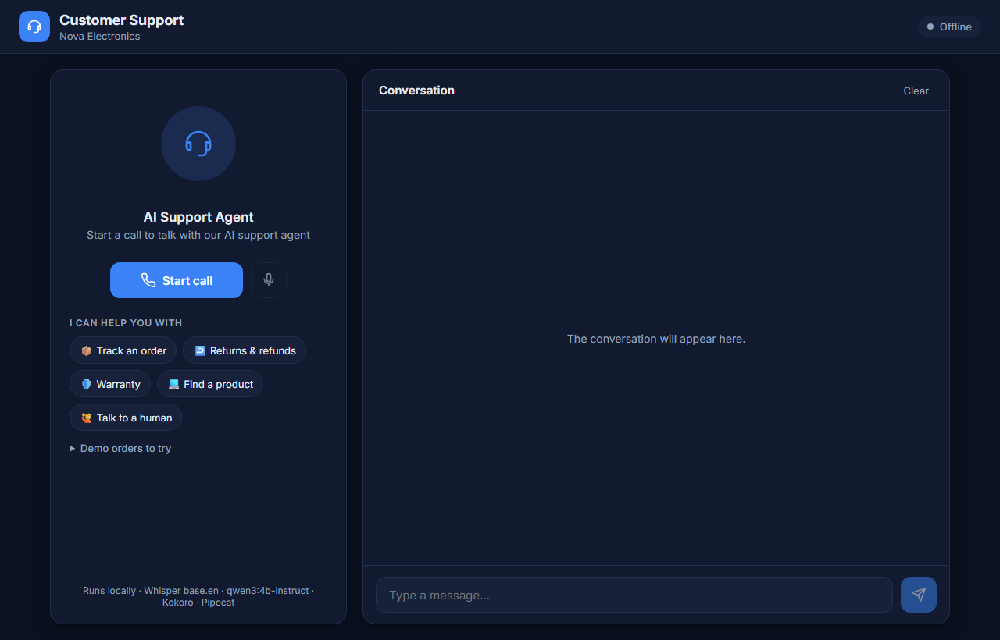

<a id="readme-top"></a>

# Customer Support Voice Agent

An AI customer support agent you can talk to from your browser. It tracks orders, explains store
policies, recommends products and hands you over to a human when needed. It answers from real
databases instead of guessing.

**Everything runs locally on your own machine: no API keys, no cloud, no cost.**



## Demo


https://github.com/user-attachments/assets/b2764816-cea1-43f3-9cdb-b00158285314


## Built With

- [Pipecat](https://github.com/pipecat-ai/pipecat): real-time voice pipeline (WebRTC, turn-taking, interruptions)
- [faster-whisper](https://github.com/SYSTRAN/faster-whisper): speech-to-text
- [Qwen3-4B](https://ollama.com/library/qwen3) on [Ollama](https://ollama.com): the LLM, with tool calling
- [Kokoro-82M](https://huggingface.co/hexgrad/Kokoro-82M): text-to-speech
- FastAPI and SQLite on the backend; Pipecat's client SDK in the browser

<p align="right">(<a href="#readme-top">back to top</a>)</p>

## Getting Started

To get a local copy up and running, follow these steps.

### Prerequisites

* Python 3.10 or newer
* [Ollama](https://ollama.com/download), with the model downloaded:
  ```sh
  ollama pull qwen3:4b-instruct
  ```
* Chrome or Edge, and a microphone

### Installation

1. Clone the repo
   ```sh
   git clone https://github.com/Kkavta16/customer-support-voice-agent.git
   cd customer-support-voice-agent
   ```
2. Install the Python packages
   ```sh
   python -m venv .venv
   .venv\Scripts\activate          # macOS/Linux: source .venv/bin/activate
   pip install -r requirements.txt
   ```
3. Download the text-to-speech model (about 350 MB)
   ```sh
   python scripts/download_models.py
   ```
4. Start the server
   ```sh
   uvicorn app.server:app --port 8000
   ```
5. Open http://localhost:8000 and click **Start call**

<p align="right">(<a href="#readme-top">back to top</a>)</p>

## Usage

Click **Start call**, wait for the greeting, then talk. You can also type in the message box. Try
this conversation:

| You say | The agent answers |
|---|---|
| "Where is my order 1001?" | Asks for the last four digits of your phone |
| "It ends in four eight two one." | Your Galaxy S24 has shipped and arrives Sunday, with the tracking number |
| "Can I return it if I don't like it?" | Yes, within 10 days of delivery, with free pickup |
| "Which phones do you have under 30,000 rupees?" | Redmi Note 13 Pro and Nothing Phone (2a), with prices |
| "Can you check order 1002? My phone ends in 0000." | Can't find a match (wrong digits on purpose: a security check) |
| "I want to talk to a human about a damaged screen. My name is Asha and my number is 98765 43210." | Creates a support ticket and reads out the number |

Other sample orders: **1002** (phone ends 1934), **1003** (7710), **1004** (5502), **1005** (3367),
**1006** (9045), **1007** (2288).

<p align="right">(<a href="#readme-top">back to top</a>)</p>
